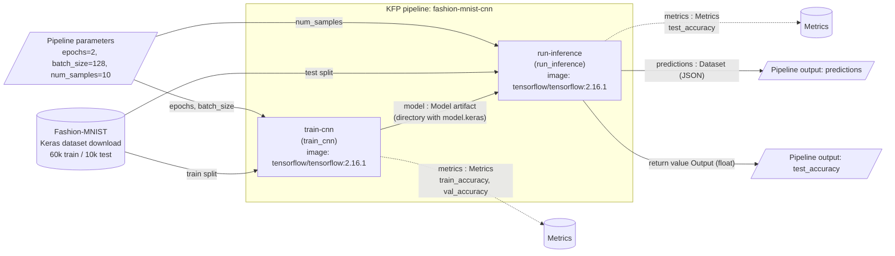
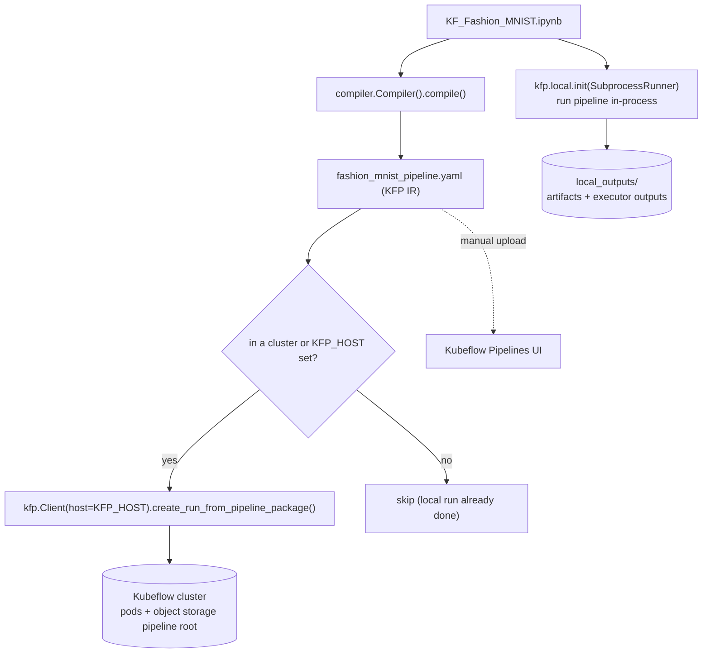

# Implementation Guide

This document explains everything in this repository: what it does, how it is built, how to run it (locally and on Kubeflow), how it was verified and what can go wrong.

---

## 1. Purpose and overview

The project is a minimal but complete **Kubeflow Pipelines v2 (KFP v2)** machine-learning workflow:

1. **Train** a convolutional neural network (CNN) on the Fashion-MNIST image dataset.
2. **Run inference** with the trained model on the full test set and report accuracy plus sample predictions.

Both steps are KFP *lightweight Python components*. The trained model moves from step 1 to step 2 as a typed KFP **`Model` artifact**, so the two steps can run in separate containers (on a cluster) or separate processes (locally) without any shared volume.

Everything is driven from one notebook, `KF_Fashion_MNIST.ipynb`, which:

* explores the dataset (shapes, class balance, sample images),
* defines the two components and the pipeline,
* compiles the pipeline to `fashion_mnist_pipeline.yaml`,
* executes the whole pipeline locally with `kfp.local` (no Kubernetes needed),
* submits the compiled pipeline to Kubeflow when it runs inside a cluster or when `KFP_HOST` is set (skipped otherwise).

The notebook is committed **executed**, so its outputs (training log, accuracy, predictions, plots) are visible without re-running it.

---

## 2. Architecture

### 2.1 Pipeline and data flow



### 2.2 Where it runs



* **Locally**, `kfp.local.SubprocessRunner` executes each component as a child Python process using the notebook's environment. The container image is ignored. Artifacts are written to `local_outputs/`.
* **On a cluster**, each component runs as a pod from `tensorflow/tensorflow:2.16.1`. At start-up the KFP launcher pip-installs the `kfp` runtime (`kfp==<sdk version> --no-deps`) into the container, then runs the component function. Artifacts live in the cluster's pipeline root (object storage such as MinIO/S3/GCS).

---

## 3. Folder and file structure

```
fashion-mnist-kfp-lab-master/
├── KF_Fashion_MNIST.ipynb        # The whole project: exploration, components, pipeline, compile, local run, cluster submit (executed)
├── fashion_mnist_pipeline.yaml   # Compiled KFP v2 pipeline (IR YAML) - generated by notebook section 2.4
├── README.md                     # Short overview, verified results, quick-start
├── IMPLEMENTATION.md             # This document
├── LICENSE                       # MIT license
├── .gitignore                    # Python/Jupyter ignores + .venv + local_outputs/
├── images/
│   ├── kf-demo-server.png               # Screenshot: creating a Kubeflow notebook server (used in README)
│   └── kf-demo-open-terminal.png        # Screenshot: opening a terminal on the notebook server (used in README)
├── .venv/                        # Local virtual environment (git-ignored, not committed)
└── local_outputs/                # kfp.local run artifacts (git-ignored, created by notebook section 2.5)
    ├── _components/              # Windows only: component source files written by the Windows launcher
    └── fashion-mnist-cnn-<timestamp>/
        ├── train-cnn/
        │   ├── model/model.keras         # Trained CNN (Model artifact directory)
        │   └── executor_output.json      # Output artifact URIs + metadata (train/val accuracy)
        └── run-inference/
            ├── predictions               # JSON list of sample predictions (Dataset artifact)
            └── executor_output.json      # test_accuracy return value + metrics metadata
```

### 3.1 Notebook map

| Section | Cell content | Role |
|---|---|---|
| Title | Markdown | What the notebook does |
| 1.1 | `%pip install -q "kfp>=2.7,<3" "tensorflow>=2.16" matplotlib pandas` | Installs dependencies into the running kernel's environment |
| 1.2 | Imports TensorFlow/Keras, NumPy, Matplotlib, pandas; prints versions | |
| 1.3 | `keras.datasets.fashion_mnist.load_data()`, `class_names` | Load dataset for exploration |
| 1.4 | Prints dataset sizes and per-class counts | Shows 60,000 / 10,000 images, 28x28, 6,000 training images per class |
| 1.5 | Plots one image with colour bar, scales to 0-1, plots a 5x5 grid with labels | Visual sanity check of the data |
| 2.1 | Imports `kfp`, `dsl`, `compiler`, `local`, artifact types; prints kfp version | |
| 2.2 | `BASE_IMAGE`, `train_cnn` component, `run_inference` component | The two pipeline steps |
| 2.3 | `PipelineOutputs`, `fashion_mnist_pipeline` | Wires train -> inference, exposes pipeline outputs |
| 2.4 | Compiles to `fashion_mnist_pipeline.yaml` | Portable artifact for clusters |
| 2.5 | Windows launcher (Windows only), `local.init(...)`, runs the pipeline; reads `test_accuracy` and `predictions` into a DataFrame | End-to-end local verification |
| 2.6 | Submits to the cluster when running in a pod (`KUBERNETES_SERVICE_HOST` present) or when `KFP_HOST` is set, otherwise prints a skip message | Optional cluster run |

---

## 4. Tech stack

| Layer | Technology | Version used for verification |
|---|---|---|
| Language | Python | 3.13.5 (Windows 11, CPU) |
| Pipeline SDK | `kfp` (Kubeflow Pipelines SDK v2) | 2.18.0 (requirement `>=2.7,<3`) |
| Pipeline spec / API client | `kfp-pipeline-spec`, `kfp-server-api` | 2.18.0 / 2.18.0 |
| ML framework | TensorFlow / Keras 3 | 2.21.0 / 3.15.1 (requirement `tensorflow>=2.16`) |
| Numerics / tables / plots | NumPy, pandas, Matplotlib | 2.5.4, 3.1.0, 3.11.2 |
| Notebook execution | nbconvert, ipykernel | 7.17.2, 7.4.0 |
| Cluster container image | `tensorflow/tensorflow:2.16.1` (Docker Hub, TensorFlow 2.16 ships Keras 3) | tag confirmed to exist on Docker Hub; not pulled here |
| Orchestrator | Kubeflow Pipelines 2.x backend (standalone or full Kubeflow) | not available here |

---

## 5. Components in detail

### 5.1 `train_cnn`

```python
@dsl.component(base_image=BASE_IMAGE)
def train_cnn(epochs: int, batch_size: int, model: Output[Model], metrics: Output[Metrics]): ...
```

| | |
|---|---|
| Inputs | `epochs` (int), `batch_size` (int) |
| Outputs | `model: Output[Model]`, `metrics: Output[Metrics]` |
| Logic | 1. Download Fashion-MNIST via `keras.datasets.fashion_mnist.load_data()` (only the train split is used). 2. Scale pixels to `[0, 1]` as `float32` and add a channel axis -> shape `(60000, 28, 28, 1)`. 3. Build and compile the CNN (section 7). 4. `fit(..., validation_split=0.1, verbose=2)` - Keras holds out the last 10% (6,000 images) for validation, so 54,000 images train (422 steps per epoch at batch size 128). 5. `os.makedirs(model.path)` and save `model.path/model.keras`. 6. Write `framework` and `epochs` into the Model artifact's metadata; log `train_accuracy` and `val_accuracy` (last epoch) to Metrics. |

Design choices:

* **Artifact instead of a shared volume.** `Output[Model]` gives the function a path (`model.path`) inside the pipeline root; KFP uploads/registers it and hands it to downstream steps. This works identically on any cluster and locally, with no PersistentVolumeClaim.
* **Model artifact is a directory** containing `model.keras`. Keras 3 requires the `.keras` extension when saving, and an artifact path has none, so the directory layout keeps the file name explicit for the consumer.
* **Imports inside the function.** Each component's source is shipped into its own container/process; module-level imports in the notebook are not available there.
* **Logits output (`Dense(10)` without softmax)** plus `from_logits=True` is numerically more stable; softmax is applied only at inference.

### 5.2 `run_inference`

```python
@dsl.component(base_image=BASE_IMAGE)
def run_inference(model: Input[Model], num_samples: int,
                  predictions: Output[Dataset], metrics: Output[Metrics]) -> float: ...
```

| | |
|---|---|
| Inputs | `model: Input[Model]` (from `train_cnn`), `num_samples` (int) |
| Outputs | `predictions: Output[Dataset]` (JSON file), `metrics: Output[Metrics]`, return value `Output` (float, test accuracy) |
| Logic | 1. Download Fashion-MNIST, use the 10,000-image test split, scale/reshape as in training. 2. `keras.models.load_model(model.path/model.keras)`. 3. `predict(batch_size=512)` -> logits; numerically stable NumPy softmax -> probabilities; `argmax` -> predicted class. 4. Accuracy = mean(predicted == true) over all 10,000 images. 5. Write the first `num_samples` predictions as JSON: `{"index", "predicted", "confidence", "actual"}` (class names, confidence = max softmax probability rounded to 4 decimals). 6. Print each sample prediction and the accuracy (visible in the pod/task logs). 7. Log `test_accuracy` to Metrics and return it. |

Design choices:

* **Reads the model only through the artifact**, which proves the hand-off between steps works.
* **Evaluates on the full test set**, so the reported accuracy is a real held-out metric, not a single-image prediction.
* **Returns accuracy as a parameter** so it can be used as a pipeline output (and by downstream steps or conditions if added later).
* The test split is re-downloaded rather than passed from step 1; this keeps step 1's outputs to just the model and keeps each step self-contained. The dataset is ~30 MB, so the cost is small.

### 5.3 Pipeline `fashion_mnist_pipeline`

```python
PipelineOutputs = NamedTuple("PipelineOutputs", [("test_accuracy", float), ("predictions", Dataset)])

@dsl.pipeline(name="fashion-mnist-cnn", description="Train a CNN on Fashion-MNIST, then run inference with the trained model.")
def fashion_mnist_pipeline(epochs: int = 2, batch_size: int = 128, num_samples: int = 10) -> PipelineOutputs:
    train_task = train_cnn(epochs=epochs, batch_size=batch_size)
    infer_task = run_inference(model=train_task.outputs["model"], num_samples=num_samples)
    return PipelineOutputs(test_accuracy=infer_task.outputs["Output"], predictions=infer_task.outputs["predictions"])
```

* The dependency `train-cnn -> run-inference` is implicit from the data dependency (`train_task.outputs["model"]`). In the compiled YAML, `run-inference` has `dependentTasks: [train-cnn]` and its `model` input is `taskOutputArtifact {producerTask: train-cnn, outputArtifactKey: model}`.
* Pipeline outputs are declared with the functional `NamedTuple` syntax; the keyword form is deprecated in Python 3.13 and removed in 3.15.
* Defaults (`epochs=2`) keep a CPU run under two minutes.

### 5.4 Compilation

`compiler.Compiler().compile(fashion_mnist_pipeline, "fashion_mnist_pipeline.yaml")` produces the KFP IR (`schemaVersion: 2.1.0`, `sdkVersion: kfp-2.18.0`). It contains the component specs, both executors (image `tensorflow/tensorflow:2.16.1`, the embedded function source, the launcher command) and the DAG.

### 5.5 Local execution and the Windows launcher

```python
local.init(runner=local.SubprocessRunner(use_venv=False), pipeline_root=os.path.abspath("local_outputs"))
local_run = fashion_mnist_pipeline(epochs=EPOCHS, batch_size=128, num_samples=NUM_SAMPLES)
```

* `use_venv=False` runs components in the notebook's own environment (TensorFlow is already installed there). `use_venv=True` would create a fresh venv per task and download TensorFlow each time.
* Calling the pipeline function after `local.init` runs the whole DAG and returns a task whose `outputs["test_accuracy"]` and `outputs["predictions"]` hold the pipeline outputs.

KFP's subprocess runner launches components through the same command used in containers: `sh -c "<pip install kfp>" sh -ec "<write source to temp file; python3 -m kfp.dsl.executor_main ...>"`. On native Windows that fails, because:

1. there is usually no `sh` on `PATH` from PowerShell/cmd, and
2. with Git Bash's `sh`, the Windows path substituted for `python3` loses its backslashes (`C:UsersSai...python.exe: command not found`), and backslashes inside the `--executor_input` JSON are unescaped (`json.decoder.JSONDecodeError: Invalid \escape`).

So, on Windows only (`os.name == "nt"`), section 2.5 replaces `kfp.local.subprocess_task_handler.run_local_subprocess` with `_run_without_sh`, which:

1. takes the component source (the argument right before `--executor_input`) and writes it to `local_outputs/_components/<function>.py`,
2. runs `sys.executable -m kfp.dsl.executor_main --component_module_path <file> --executor_input <json> --function_to_execute <name>` as a list (no shell), with `_KFP_RUNTIME=true` set like in a container,
3. delegates to the original `run_local_subprocess`, so logging/streaming and status handling are unchanged.

This is exactly what the container command does after its `pip install kfp` step (kfp is already installed in the venv). On Linux/macOS the stock runner is used unchanged. The launcher relies on a KFP-internal function name, so re-check it if you upgrade `kfp` beyond 2.18.

### 5.6 Cluster submission

```python
KFP_HOST = os.environ.get("KFP_HOST")
IN_CLUSTER = "KUBERNETES_SERVICE_HOST" in os.environ
if KFP_HOST or IN_CLUSTER:
    client = kfp.Client(host=KFP_HOST)
    run = client.create_run_from_pipeline_package(PIPELINE_YAML, arguments={...}, run_name="fashion-mnist-cnn run",
                                                  experiment_name="fashion_mnist_kubeflow", namespace=os.environ.get("KFP_NAMESPACE"))
```

* In a pod (Kubernetes always sets `KUBERNETES_SERVICE_HOST`), `kfp.Client(host=None)` resolves the in-cluster Pipelines endpoint and, in kfp 2.18, attaches the projected service-account token (`ServiceAccountTokenVolumeCredentials`). That is why no host is passed in-cluster: an explicit host skips these default credentials.
* Outside a cluster, `KFP_HOST` must point at the API (for example a port-forwarded `ml-pipeline-ui`).
* Otherwise the cell prints a skip message, so the notebook runs end-to-end on machines without a cluster.

---

## 6. Dataset

| Property | Value |
|---|---|
| Name | Fashion-MNIST (Zalando Research), MIT license |
| Source | `keras.datasets.fashion_mnist.load_data()` (downloads four gzip files from Google Cloud Storage on first use) |
| Cache | `~/.keras/datasets/` (or `$KERAS_HOME/datasets/` when `KERAS_HOME` is set) |
| Train / test | 60,000 / 10,000 grayscale images, `uint8`, 28x28 |
| Classes | 0 T-shirt/top, 1 Trouser, 2 Pullover, 3 Dress, 4 Coat, 5 Sandal, 6 Shirt, 7 Sneaker, 8 Bag, 9 Ankle boot |
| Balance | 6,000 training images per class (printed in notebook section 1.4); the test set has 1,000 per class |
| Preprocessing (in components) | `x / 255.0` -> `float32`, add channel axis -> `(N, 28, 28, 1)` |
| Validation | last 10% of the training arrays (6,000 images) via `validation_split=0.1` |

---

## 7. Model

### 7.1 Layers

| # | Layer | Config | Output shape | Params |
|---|---|---|---|---|
| 0 | Input | `(28, 28, 1)` | `(None, 28, 28, 1)` | 0 |
| 1 | Conv2D | 32 filters, 3x3, ReLU, valid padding | `(None, 26, 26, 32)` | 320 |
| 2 | MaxPooling2D | 2x2 | `(None, 13, 13, 32)` | 0 |
| 3 | Conv2D | 64 filters, 3x3, ReLU | `(None, 11, 11, 64)` | 18,496 |
| 4 | MaxPooling2D | 2x2 | `(None, 5, 5, 64)` | 0 |
| 5 | Flatten | | `(None, 1600)` | 0 |
| 6 | Dropout | rate 0.3 (training only) | `(None, 1600)` | 0 |
| 7 | Dense | 128, ReLU | `(None, 128)` | 204,928 |
| 8 | Dense | 10, linear (logits) | `(None, 10)` | 1,290 |
| | **Total trainable** | | | **225,034** |

(Shapes and counts taken from `model.summary()` of the trained `model.keras`. The saved file is ~2.7 MB because it also stores Adam optimizer state.)

### 7.2 Hyperparameters

| Hyperparameter | Value | Where |
|---|---|---|
| Optimizer | Adam (Keras default, learning rate 0.001) | `train_cnn` |
| Loss | `SparseCategoricalCrossentropy(from_logits=True)` | `train_cnn` |
| Metric | accuracy | `train_cnn` |
| Epochs | 2 (pipeline parameter `epochs`) | pipeline / notebook `EPOCHS` |
| Batch size | 128 (pipeline parameter `batch_size`) | pipeline |
| Validation split | 0.1 | `train_cnn` |
| Dropout | 0.3 | `train_cnn` |
| Inference batch size | 512 | `run_inference` |
| Sample predictions | 10 (pipeline parameter `num_samples`) | pipeline / notebook `NUM_SAMPLES` |
| Random seed | none (results vary between runs) | |

---

## 8. Setup from a clean machine

Prerequisites: Python 3 with `venv` and pip, internet access. Git is only needed to clone the repo. No Docker or Kubernetes is needed for the local run.

### 8.1 Windows (PowerShell)

```powershell
cd fashion-mnist-kfp-lab-master
python -m venv .venv
.\.venv\Scripts\python.exe -m pip install --upgrade pip
.\.venv\Scripts\python.exe -m pip install "kfp>=2.7,<3" "tensorflow>=2.16" matplotlib pandas nbconvert ipykernel
```

If the TensorFlow install fails with `OSError: [Errno 2] No such file or directory ... HINT: This error might have occurred since this system does not have Windows Long Path support enabled`, see Troubleshooting 12.1.

### 8.2 Linux / macOS

```bash
cd fashion-mnist-kfp-lab-master
python3 -m venv .venv
.venv/bin/python -m pip install --upgrade pip
.venv/bin/python -m pip install "kfp>=2.7,<3" "tensorflow>=2.16" matplotlib pandas nbconvert ipykernel
```

### 8.3 Kubeflow notebook server

Create a notebook server from the Kubeflow dashboard, open a terminal (New > Terminal), clone the repository and open `KF_Fashion_MNIST.ipynb`. Section 1.1 installs the packages into the server's Python environment.

---

## 9. How to run

### 9.1 Locally, headless (re-executes and saves the notebook)

Windows:

```powershell
.\.venv\Scripts\jupyter-nbconvert.exe --to notebook --execute --inplace --ExecutePreprocessor.timeout=1800 KF_Fashion_MNIST.ipynb
```

Linux / macOS:

```bash
.venv/bin/jupyter nbconvert --to notebook --execute --inplace --ExecutePreprocessor.timeout=1800 KF_Fashion_MNIST.ipynb
```

Results: `fashion_mnist_pipeline.yaml` is regenerated, artifacts land in `local_outputs/fashion-mnist-cnn-<timestamp>/`, and the notebook cells show the training log, test accuracy and a predictions table.

### 9.2 Locally, interactive

Open the notebook in JupyterLab or VS Code, select the `.venv` interpreter as kernel, and Run All. Change `EPOCHS` / `NUM_SAMPLES` in section 2.5 to experiment.

### 9.3 On a Kubeflow cluster

Option A - UI: Kubeflow Pipelines UI -> Pipelines -> Upload pipeline -> choose `fashion_mnist_pipeline.yaml` -> Create run (parameters `epochs`, `batch_size`, `num_samples` are editable in the form).

Option B - from the notebook:

1. Make the API reachable:
   * In a Kubeflow notebook server: nothing to set; create the server with "Allow access to Kubeflow Pipelines" enabled so the service-account token is mounted.
   * From a workstation: `kubectl port-forward -n kubeflow svc/ml-pipeline-ui 8080:80`, then set `KFP_HOST=http://localhost:8080` before starting Jupyter.
   * Multi-user Kubeflow: also set `KFP_NAMESPACE=<your-profile-namespace>`.
2. Run the notebook; section 2.6 prints the created run id. Follow the run in the UI: `train-cnn` logs show the epoch lines, `run-inference` logs show the sample predictions and `Test accuracy on 10000 images: ...`, and the Metrics artifacts show `train_accuracy`, `val_accuracy` and `test_accuracy`.

Cluster requirements: pods need outbound internet (pip install of `kfp` at container start, Fashion-MNIST download) and the ability to pull `tensorflow/tensorflow:2.16.1` from Docker Hub. CPU is enough; the pods use the default resources (no requests/limits set).

---

## 10. Configuration and environment variables

| Name | Used by | Purpose |
|---|---|---|
| `KFP_HOST` | Notebook section 2.6 | KFP API endpoint; required outside a cluster, optional inside one |
| `KFP_NAMESPACE` | Notebook section 2.6 | Kubeflow profile namespace for multi-user installs (optional) |
| `KERAS_HOME` | Keras | Optional: directory for the Keras config and dataset cache |
| `TF_CPP_MIN_LOG_LEVEL` | TensorFlow | Optional: `2` hides TensorFlow's C++ info logs |
| `KUBERNETES_SERVICE_HOST` | Notebook section 2.6 | Set by Kubernetes in every pod; its presence triggers in-cluster submission |
| `_KFP_RUNTIME` | KFP executor | Set to `true` internally by the Windows launcher, as KFP does in containers; not user-facing |

In-code configuration: `BASE_IMAGE` (section 2.2), pipeline parameter defaults (section 2.3), `PIPELINE_YAML` (section 2.4), `EPOCHS` / `NUM_SAMPLES` and the `local_outputs` pipeline root (section 2.5), run and experiment names (section 2.6).

---

## 11. Verification and results

All runs: Windows 11, CPU only, Python 3.13.5, kfp 2.18.0, TensorFlow 2.21.0, Keras 3.15.1. No Docker and no Kubernetes cluster were available, so the local `SubprocessRunner` was used.

| What was checked | How | Result |
|---|---|---|
| Notebook runs end-to-end | `jupyter-nbconvert --to notebook --execute --inplace --ExecutePreprocessor.timeout=1800 KF_Fashion_MNIST.ipynb` from PowerShell (no `sh` on `PATH`) | Exit code 0, 18 code cells executed, 0 error outputs, ~3 min total |
| Train step | Section 2.5 log | `train-cnn` status `SUCCESS`; epoch 1: acc 0.7978 / val 0.8465; epoch 2: acc 0.8643 / val 0.8862 |
| Model artifact hand-off | `local_outputs/.../train-cnn/model/model.keras` (2,740,377 bytes) written by `train-cnn` and loaded by `run-inference` | Loaded successfully |
| Inference step | Section 2.5 log | `run-inference` status `SUCCESS`; **test accuracy 0.8800 on 10,000 images**; 10/10 sample predictions correct |
| Pipeline status | Section 2.5 log | `Pipeline 'fashion-mnist-cnn' finished with status SUCCESS`, ~1.5 min |
| Pipeline outputs | Section 2.5 second cell | `test_accuracy` = 0.8800, `predictions` JSON read into a DataFrame |
| Cluster cell | Section 2.6 | Printed the skip message (no cluster, no `KFP_HOST`) |
| Compilation | Section 2.4 + `yaml.safe_load` + `kfp.components.load_component_from_file` | 9,092-byte YAML, re-loads as `fashion-mnist-cnn`; `run-inference` depends on `train-cnn` and consumes its `model` artifact; both executors use `tensorflow/tensorflow:2.16.1` |
| Cluster runtime with `--no-deps` kfp | Fresh venv with only `kfp==2.18.0 --no-deps`, ran `python -m kfp.dsl.executor_main` with `_KFP_RUNTIME=true` on a component using `Input[Model]`, `Output[Dataset]`, `Output[Metrics]` and a float return | Artifacts and executor output written correctly (mirrors what the cluster launcher installs) |
| Cluster run | - | **Not verified** (no cluster/Docker). The image tag was confirmed to exist on Docker Hub. |

Other runs during development (same model and pipeline code): 2 epochs -> 0.8633, 0.8729 and 0.8674 test accuracy; 1 epoch -> 0.8415. Variation comes from unseeded weight initialisation and shuffling.

---

## 12. Troubleshooting

### 12.1 TensorFlow install fails on Windows (long paths)
Symptom: `ERROR: Could not install packages due to an OSError: [Errno 2] No such file or directory: '...\.venv\Lib\site-packages\tensorflow\include\external\...upb_minitable.h'` with a hint about Windows Long Path support; afterwards `import tensorflow` fails with `ModuleNotFoundError: No module named 'tensorflow.python'`.
Cause: some TensorFlow header paths exceed the 260-character Windows limit when the project sits in a deep folder.
Fix (either):
* Enable long paths (admin PowerShell, then reopen the terminal): `New-ItemProperty -Path HKLM:\SYSTEM\CurrentControlSet\Control\FileSystem -Name LongPathsEnabled -Value 1 -PropertyType DWORD -Force`
* Or shorten the path: move the project closer to the drive root, or create and install the venv through the folder's 8.3 short name (find it with `cmd /c "for %I in (.) do @echo %~sI"`, then delete `.venv` and run `python -m venv <short-path>\.venv` and `<short-path>\.venv\Scripts\python.exe -m pip install ...`). The second option is what was used here.

### 12.2 `kfp.local` fails on Windows
Symptoms: `sh: line 6: C:UsersSai...python.exe: command not found`, `json.decoder.JSONDecodeError: Invalid \escape`, or `FileNotFoundError` for `sh`.
Cause: the KFP subprocess runner uses a POSIX shell launcher (section 5.5).
Fix: already handled by the Windows launcher in section 2.5. If you copy the pipeline into another script, copy that `if os.name == "nt":` block too, and run it before calling the pipeline.

### 12.3 Harmless warnings in the local run
* `RuntimeWarning: You may be attemping to run a task that uses custom or non-Python base image "tensorflow/tensorflow:2.16.1"` - the local runner ignores images; expected.
* `TensorFlow GPU support is not available on native Windows for TensorFlow >= 2.11` - CPU is used; expected.
* `Automatic preview unavailable for output 'model' / 'predictions'` - KFP executor preview feature; artifacts are unaffected.
* `oneDNN custom operations are on ...` - TensorFlow info log; hide with `TF_CPP_MIN_LOG_LEVEL=2`.
* `Note: you may need to restart the kernel to use updated packages.` after `%pip install` - only needed if packages were actually upgraded.

### 12.4 Dataset download fails
Symptom: `Exception: URL fetch failure on https://storage.googleapis.com/...`.
Fix: allow outbound HTTPS (proxy/firewall), or pre-populate the Keras cache (`$KERAS_HOME/datasets/fashion-mnist/`). On a cluster without egress, bake the dataset into a custom image.

### 12.5 Cluster pods fail before the component starts
Symptom: errors from `pip install kfp==2.18.0` in the pod log, or `ImagePullBackOff`.
Fix: give pods internet access or a PyPI mirror, and allow pulls from Docker Hub; alternatively build an image `FROM tensorflow/tensorflow:2.16.1` with `kfp==<your SDK version>` preinstalled and set `BASE_IMAGE` to it.

### 12.6 Submission errors
* Connection refused / timeouts: check `KFP_HOST` and the port-forward.
* `401`/`403` or namespace errors on multi-user Kubeflow: set `KFP_NAMESPACE` to your profile namespace. Inside a notebook server do not set `KFP_HOST` (an explicit host skips the service-account token) and make sure "Allow access to Kubeflow Pipelines" was enabled for the server. From outside, the port-forwarded endpoint may require your Kubeflow login; follow your installation's authentication guide.

### 12.7 `DeprecationWarning: Creating NamedTuple classes using keyword arguments is deprecated`
Fixed already: pipeline outputs use the functional `NamedTuple("PipelineOutputs", [(name, type), ...])` form.

---

## 13. Limitations and next steps

Limitations:

* **Cluster execution is unverified here**; only compilation, the YAML wiring and the `--no-deps` KFP runtime were checked.
* **Local and cluster TensorFlow differ** (2.21 locally vs 2.16.1 in the image). Each run saves and loads the model with the same version, so this does not break the pipeline, but numbers can differ slightly.
* **No seeding** - test accuracy varied between 0.8633 and 0.8800 across four 2-epoch runs.
* **Short training** (2 epochs, 0.86-0.88 test accuracy across verified runs) to keep runs fast.
* Each step downloads the dataset itself; pods need internet access.
* No resource requests/limits, GPU configuration, caching policy or retries are set on the tasks.
* The Windows launcher patches a KFP-internal function (`kfp.local.subprocess_task_handler.run_local_subprocess`), verified with kfp 2.18.0 only.

Possible next steps:

* Add `keras.utils.set_random_seed(...)` for reproducible metrics.
* Raise `epochs`, add data augmentation or batch normalisation for higher accuracy.
* Build a custom image with TensorFlow, `kfp` and the dataset baked in to remove runtime downloads.
* Add a `dsl.If` gate on `test_accuracy` and a deployment step (e.g. KServe) for models that pass.
* Set `task.set_cpu_limit(...)` / `set_memory_limit(...)` / accelerators for cluster runs.
* Hyperparameter tuning with Katib.
