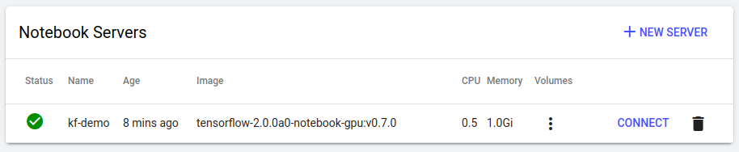
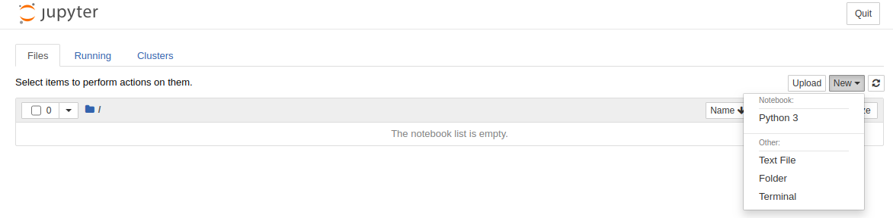

# Fashion-MNIST CNN on Kubeflow Pipelines

A two-step [Kubeflow Pipelines](https://www.kubeflow.org/docs/components/pipelines/) (KFP v2) workflow that trains a convolutional neural network on [Fashion-MNIST](https://github.com/zalandoresearch/fashion-mnist) and then runs inference with the trained model. Everything lives in one notebook, `KF_Fashion_MNIST.ipynb`, which explores the data, defines the components and pipeline, compiles it to YAML, runs it locally (no cluster needed) and can optionally submit it to a Kubeflow cluster.

For a full walkthrough of the design, code and troubleshooting see [IMPLEMENTATION.md](IMPLEMENTATION.md).

## Pipeline

```
fashion-mnist-cnn
  train-cnn  --(Model artifact: model.keras)-->  run-inference
```

| Step | Component | Inputs | Outputs |
|---|---|---|---|
| 1 | `train_cnn` | `epochs` (int), `batch_size` (int) | `model` (`Model`, contains `model.keras`), `metrics` (`Metrics`: `train_accuracy`, `val_accuracy`) |
| 2 | `run_inference` | `model` (`Model` from step 1), `num_samples` (int) | `predictions` (`Dataset`, JSON of the first `num_samples` test predictions), `metrics` (`Metrics`: `test_accuracy`), return value `test_accuracy` (float) |

Pipeline parameters: `epochs=2`, `batch_size=128`, `num_samples=10`. Pipeline outputs: `test_accuracy`, `predictions`.

Model: `Conv2D(32) -> MaxPool -> Conv2D(64) -> MaxPool -> Flatten -> Dropout(0.3) -> Dense(128) -> Dense(10)` (225,034 trainable parameters), Adam, sparse categorical cross-entropy. Both components use the `tensorflow/tensorflow:2.16.1` image on a cluster.

## Verified results

Local run of the full pipeline (`kfp.local.SubprocessRunner`, CPU, Windows 11, Python 3.13.5, kfp 2.18.0, TensorFlow 2.21.0 / Keras 3.15.1), 2 epochs, captured in the executed notebook:

| Metric | Value |
|---|---|
| Train accuracy (epoch 2) | 0.8643 |
| Validation accuracy (epoch 2) | 0.8862 |
| **Test accuracy (10,000 images, inference step)** | **0.8800** |
| Wall time, whole pipeline | ~1.5 min (whole notebook ~3 min) |

Both tasks and the pipeline finished with status `SUCCESS`; all 10 sample predictions were correct. Numbers vary per run because training is not seeded: other 2-epoch runs gave 0.8633, 0.8729 and 0.8674 test accuracy, a 1-epoch run gave 0.8415.

## Run locally (no cluster)

Requires Python (verified with 3.13.5) and internet access (pip packages and the Fashion-MNIST download).

Windows (PowerShell):

```powershell
python -m venv .venv
.\.venv\Scripts\python.exe -m pip install "kfp>=2.7,<3" "tensorflow>=2.16" matplotlib pandas nbconvert ipykernel
.\.venv\Scripts\jupyter-nbconvert.exe --to notebook --execute --inplace --ExecutePreprocessor.timeout=1800 KF_Fashion_MNIST.ipynb
```

Linux / macOS:

```bash
python3 -m venv .venv
.venv/bin/pip install "kfp>=2.7,<3" "tensorflow>=2.16" matplotlib pandas nbconvert ipykernel
.venv/bin/jupyter nbconvert --to notebook --execute --inplace --ExecutePreprocessor.timeout=1800 KF_Fashion_MNIST.ipynb
```

Or open the notebook in Jupyter/VS Code with the `.venv` kernel and run all cells. The local run writes the compiled `fashion_mnist_pipeline.yaml` and the task artifacts under `local_outputs/` (git-ignored).

Notes:
* `kfp.local.SubprocessRunner` runs components in the notebook's own Python environment and ignores the container image. Its launcher is a POSIX `sh` script, so on Windows the notebook swaps in a small launcher that calls the KFP executor directly (no `sh` needed); on Linux/macOS the stock runner is used.
* On Windows, installing TensorFlow can fail with a "Windows Long Path support" error. See IMPLEMENTATION.md, Troubleshooting.

## Run on a Kubeflow cluster

Any Kubeflow Pipelines 2.x installation works (standalone KFP or full Kubeflow).

1. Compile (already done by the notebook): `fashion_mnist_pipeline.yaml`.
2. Either upload it in the Kubeflow Pipelines UI (Pipelines > Upload pipeline) and create a run, or let section 2.6 of the notebook submit it with `kfp.Client(...).create_run_from_pipeline_package(...)`:
   * Inside a Kubeflow notebook server it submits automatically (in-cluster endpoint + the notebook's service-account token; enable "Allow access to Kubeflow Pipelines" on the notebook server).
   * Elsewhere set `KFP_HOST` before starting Jupyter, e.g. `http://localhost:8080` after `kubectl port-forward -n kubeflow svc/ml-pipeline-ui 8080:80`.
   * On multi-user Kubeflow also set `KFP_NAMESPACE` to your profile namespace.
3. Pods need outbound internet access: the KFP launcher pip-installs `kfp` into the TensorFlow image and both steps download Fashion-MNIST.

From a Kubeflow notebook server you can create a server from the dashboard, open a terminal and clone this repository:





Cluster execution was not verified here (no cluster or Docker available); the YAML compiles, re-loads with `kfp.components.load_component_from_file`, and the artifact wiring was checked in the compiled spec.

## Files

| Path | Purpose |
|---|---|
| `KF_Fashion_MNIST.ipynb` | Data exploration, components, pipeline, compile, local run, optional cluster submit (executed, with outputs) |
| `fashion_mnist_pipeline.yaml` | Compiled KFP v2 pipeline definition |
| `IMPLEMENTATION.md` | Detailed implementation guide |
| `images/` | Screenshots used in this README |
| `LICENSE` | MIT license |
